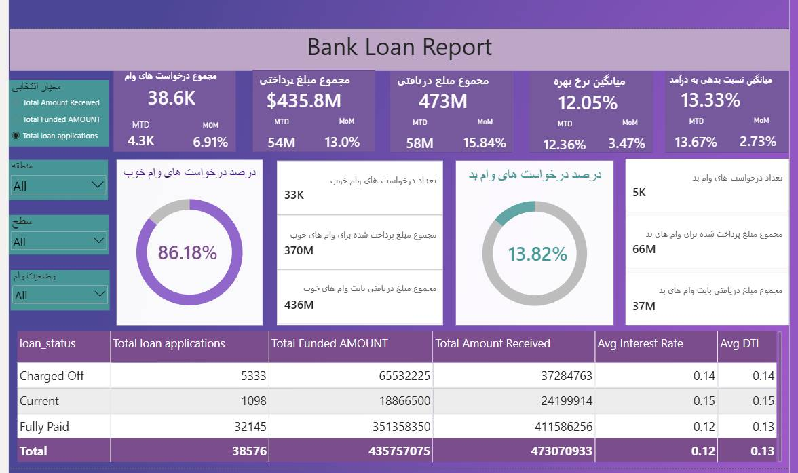
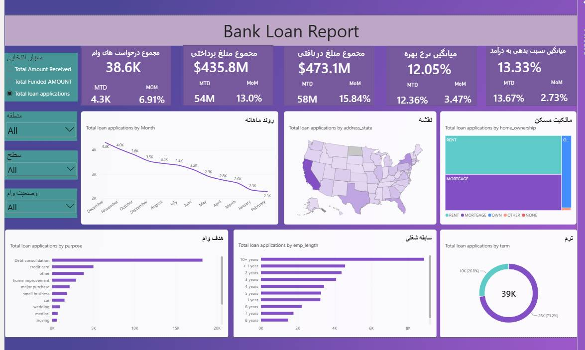

#  پروژه گزارش وام‌های بانکی(Bank Loan Report)

## معرفی پروژه
این پروژه با هدف تحلیل و مصورسازی شاخص‌ها و روندهای کلیدی مرتبط با وام‌های
بانکی طراحی شده است. داشبوردهای تعاملی، اطلاعات مربوط به درخواست‌های وام،
مبالغ تأمین‌شده و مبالغ دریافتی را از ابعاد زمانی، جغرافیایی و ویژگی‌های
وام‌گیرندگان نمایش می‌دهند
------------------------------------------------------------------------

## داشبورد 1 : 

 
## ۱. الزامات مربوط به شاخص‌های کلیدی عملکرد (KPIs)

### ۱.۱. مجموع درخواست‌های وام

باید تعداد کل درخواست‌های وام دریافتی در یک دوره زمانی مشخص را محاسبه
کنیم. علاوه بر این، پایش مجموع درخواست‌های وام از ابتدای ماه تا کنون
(MTD) و رصد تغییرات ماهانه (MoM) ضروری است.

### ۱.۲. مجموع مبلغ تأمین‌شده (پرداختی)

آگاهی از کل مبلغی که در قالب وام پرداخت شده، بسیار حائز اهمیت است.
همچنین باید مجموع مبلغ پرداخت‌شده از ابتدای ماه تا کنون (MTD) را زیر نظر
داشته باشیم و تغییرات ماهانه (MoM) در این شاخص را تحلیل کنیم.

### ۱.۳. مجموع مبلغ دریافتی

رصد کل مبلغ دریافتی از وام‌گیرندگان برای ارزیابی جریان نقدینگی بانک و
بازپرداخت وام‌ها ضروری است. باید مجموع مبلغ دریافتی از ابتدای ماه تا کنون
(MTD) را تحلیل کرده و تغییرات ماهانه (MoM) آن را بررسی کنیم.

### ۱.۴. میانگین نرخ بهره

محاسبه میانگین نرخ بهره برای تمامی وام‌ها (از ابتدای ماه تا کنون) و پایش
نوسانات ماهانه (MoM) در نرخ‌های بهره، بینشی درباره هزینه کلی سبد وام‌های
ما فراهم می‌کند.

### ۱.۵. میانگین نسبت بدهی به درآمد (DTI)

ارزیابی میانگین نسبت بدهی به درآمد (DTI) برای وام‌گیرندگان، به ما در سنجش
سلامت مالی آن‌ها کمک می‌کند. باید میانگین DTI را برای تمامی وام‌ها (از
ابتدای ماه تا کنون) محاسبه کرده و نوسانات ماهانه (MoM) آن را رصد نماییم.

------------------------------------------------------------------------

## ۲. شاخص‌های کلیدی عملکرد (KPIs) برای وام‌های «خوب» و «بد»

به‌منظور ارزیابی عملکرد فعالیت‌های وام‌دهی و سنجش کیفیت سبد وام‌هایمان، باید
گزارشی جامع تهیه کنیم که بر اساس معیارهای مشخصِ وضعیت وام، میان «وام‌های
خوب» و «وام‌های بد» تمایز قائل شود.

### ۲.۱. شاخص‌های کلیدی عملکرد برای وام‌های خوب

**۱. درصد درخواست‌های وام خوب**

محاسبه درصد درخواست‌های وامی که در دسته «وام‌های خوب» طبقه‌بندی می‌شوند. این
دسته شامل وام‌هایی است که وضعیت آن‌ها «کاملاً تسویه شده» (Fully Paid) یا
«جاری» (Current) است.

**۲. تعداد درخواست‌های وام خوب**

تعیین تعداد کل درخواست‌های وامی که در دسته «وام‌های خوب» قرار می‌گیرند؛
یعنی وام‌هایی با وضعیت «کاملاً تسویه شده» یا «جاری».

**۳. مبلغ پرداخت‌شده برای وام‌های خوب**

تعیین مجموع وجوهی که در قالب «وام‌های خوب» پرداخت (تخصیص داده) شده است.
این شامل مبلغ اصل وام‌هایی می‌شود که وضعیت آن‌ها «کاملاً تسویه شده» یا
«جاری» است.

**۴. مجموع مبالغ دریافتی بابت وام‌های خوب**

ردیابی کل مبلغ دریافتی از وام‌گیرندگان در خصوص «وام‌های خوب»؛ که شامل
تمامی پرداخت‌های انجام‌شده برای وام‌هایی با وضعیت «کاملاً تسویه شده» یا
«جاری» است.

### ۲.۲. شاخص‌های کلیدی عملکرد برای وام‌های بد

**۱. درصد درخواست‌های وام بد**

محاسبه درصد درخواست‌های وامی که در دسته «وام‌های بد» طبقه‌بندی می‌شوند. این
دسته به‌طور مشخص شامل وام‌هایی است که وضعیت آن‌ها «سوخت‌شده» یا «غیرقابل
وصول» (Charged Off) می‌باشد.

**۲. تعداد درخواست‌های وام بد**

تعیین تعداد کل درخواست‌های وامی که در دسته «وام‌های بد» قرار می‌گیرند؛ یعنی
وام‌هایی با وضعیت «سوخت‌شده» (Charged Off).

**۳. مبلغ پرداخت‌شده برای وام‌های بد**

تعیین مجموع وجوهی که در قالب «وام‌های بد» پرداخت (تخصیص داده) شده است.
این شامل مبلغ اصل وام‌هایی می‌شود که وضعیت آن‌ها «سوخت‌شده» (Charged Off)
است.

**۴. مجموع مبالغ دریافتی بابت وام‌های بد**

ردیابی کل مبلغ دریافتی از وام‌گیرندگان در خصوص «وام‌های بد»؛ که شامل تمامی
پرداخت‌های انجام‌شده برای وام‌هایی با وضعیت «سوخت‌شده» (Charged Off) است.

------------------------------------------------------------------------

## ۳. نمای جدولی وضعیت وام‌ها (Loan Status Grid View)

به‌منظور دستیابی به دیدگاهی جامع از عملیات وام‌دهی و پایش عملکرد وام‌ها،
قصد داریم یک گزارش به صورت نمای جدولی (Grid View) ایجاد کنیم که بر اساس
«وضعیت وام» (Loan Status) دسته‌بندی شده باشد.

این گزارش ابزاری ارزشمند برای تحلیل و درک شاخص‌های کلیدی مرتبط با
وضعیت‌های مختلف وام خواهد بود.

این نمای جدولی با ارائه بینش‌هایی درباره معیارهای زیر، ما را قادر می‌سازد
تا تصمیماتی مبتنی بر داده اتخاذ کنیم و سلامت سبد وام‌های خود را ارزیابی
نماییم:

-   تعداد کل درخواست‌های وام
-   مجموع مبلغ تأمین‌شده
-   مجموع مبلغ دریافتی
-   مبلغ تأمین‌شده از ابتدای ماه تا کنون (MTD)
-   مبلغ دریافتی از ابتدای ماه تا کنون (MTD)
-   میانگین نرخ بهره
-   میانگین نسبت بدهی به درآمد (DTI)

------------------------------------------------------------------------

## ۴. داشبورد ۲: 

در پروژه «گزارش وام‌های بانکی»، هدف ما نمایش بصری معیارها و روندهای حیاتی
مرتبط با وام‌ها با استفاده از انواع نمودارهاست.

این نمودارها تصویری شفاف و آگاهی‌بخش از عملیات وام‌دهی ارائه می‌دهند که
تصمیم‌گیری مبتنی بر داده را تسهیل کرده و امکان کسب بینش‌های ارزشمند درباره
پارامترهای گوناگون وام را فراهم می‌سازد.

در ادامه، الزامات مربوط به نمودارهای خاص آمده است:

### ۴.۱. روندهای ماهانه بر اساس تاریخ صدور (نمودار خطی)

-   **نوع نمودار:** نمودار خطی (Line Chart)
-   **معیارها:** «تعداد کل درخواست‌های وام»، «مجموع مبلغ تأمین‌شده» و
    «مجموع مبلغ دریافتی»
-   **محور افقی (X):** ماه (بر اساس «تاریخ صدور»)
-   **محور عمودی (Y):** مقادیر معیارها

**هدف:**

این نمودار خطی نشان می‌دهد که «تعداد کل درخواست‌های وام»، «مجموع مبلغ
تأمین‌شده» و «مجموع مبلغ دریافتی» چگونه در طول زمان تغییر می‌کنند؛ این امر
به ما اجازه می‌دهد تا الگوهای فصلی و روندهای بلندمدت در فعالیت‌های وام‌دهی
را شناسایی کنیم.

### ۴.۲. تحلیل منطقه‌ای بر اساس ایالت (نقشه رنگ‌بندی‌شده / Filled Map)

-   **نوع نمودار:** نقشه رنگ‌بندی‌شده (Filled Map)
-   **معیارها:** «تعداد کل درخواست‌های وام»، «مجموع مبلغ تأمین‌شده» و
    «مجموع مبلغ دریافتی»
-   **مناطق جغرافیایی:** ایالت‌ها

**هدف:**

این نقشه (Filled Map) معیارهای وام‌دهی را بر اساس ایالت به صورت بصری
نمایش می‌دهد و به ما امکان می‌دهد مناطقی با فعالیت وام‌دهی قابل‌توجه را
شناسایی کرده و تفاوت‌های منطقه‌ای را ارزیابی کنیم.

### ۴.۳. تحلیل مدت‌زمان وام (نمودار حلقه‌ای)

-   **نوع نمودار:** نمودار حلقه‌ای (Donut Chart)
-   **معیارها:** «تعداد کل درخواست‌های وام»، «مجموع مبلغ تأمین‌شده» و
    «مجموع مبلغ دریافتی»
-   **بخش‌ها:** مدت‌زمان وام (برای مثال: ۳۶ ماه، ۶۰ ماه)

**هدف:**

این نمودار حلقه‌ای آمار وام‌ها را بر اساس مدت‌زمان‌های مختلف نمایش می‌دهد و
به ما کمک می‌کند تا توزیع وام‌ها را در بازه‌های زمانی گوناگون درک کنیم.

### ۴.۴. تحلیل سابقه شغلی (نمودار میله‌ای)

-   **نوع نمودار:** نمودار میله‌ای (Bar Chart)
-   **معیارها:** «تعداد کل درخواست‌های وام»، «مجموع مبلغ تأمین‌شده» و
    «مجموع مبلغ دریافتی»
-   **محور افقی (X):** دسته‌بندی‌های سابقه شغلی (برای مثال: ۱ سال، ۵ سال،
    بیش از ۱۰ سال)
-   **محور عمودی (Y):** مقادیر معیارها

**هدف:**

این نمودار میله‌ای نشان می‌دهد که معیارهای وام‌دهی چگونه در میان
وام‌گیرندگانی با سوابق شغلی متفاوت توزیع شده‌اند؛ این امر به ارزیابی تأثیر
سابقه شغلی بر درخواست‌های وام کمک می‌کند.

### ۴.۵. تفکیک بر اساس هدف وام (نمودار میله‌ای)

-   **نوع نمودار:** نمودار میله‌ای (Bar Chart)
-   **معیارها:** «تعداد کل درخواست‌های وام»، «مجموع مبلغ تأمین‌شده» و
    «مجموع مبلغ دریافتی»
-   **محور افقی (X):** دسته‌بندی‌های هدف وام (برای مثال: تجمیع بدهی‌ها،
    بازپرداخت بدهی کارت اعتباری)
-   **محور عمودی (Y):** مقادیر معیارها

**هدف:**

این نمودار میله‌ای تفکیک بصری معیارهای وام را بر اساس اهداف اعلام‌شده برای
دریافت وام ارائه می‌دهد و به درک دلایل اصلی اقدام وام‌گیرندگان برای دریافت
تسهیلات کمک می‌کند.

### ۴.۶. تحلیل وضعیت مالکیت مسکن (نمودار درختی - Tree Map)

-   **نوع نمودار:** نمودار درختی (Tree Map)
-   **معیارها:** «تعداد کل درخواست‌های وام»، «مجموع مبلغ تأمین‌شده» و
    «مجموع مبلغ دریافتی»
-   **سلسله‌مراتب:** دسته‌بندی‌های مالکیت مسکن (مانند: مالک، مستأجر، دارای
    وام مسکن/رهنی)

**هدف:**

این نمودار درختی، معیارهای مربوط به وام را بر اساس وضعیت‌های مختلف مالکیت
مسکن دسته‌بندی و نمایش می‌دهد. این امر امکان مشاهده سلسله‌مراتبیِ تأثیر نوع
مالکیت مسکن بر درخواست‌های وام و پرداخت‌های انجام‌شده را فراهم می‌سازد.

این انواع متنوع نمودار، توانایی ما را در مصورسازی و انتقال مؤثر بینش‌های
مرتبط با وام افزایش می‌دهند و از تصمیم‌گیری‌های مبتنی بر داده و برنامه‌ریزی
استراتژیک در عملیات اعطای وام پشتیبانی می‌کنند.

------------------------------------------------------------------------

